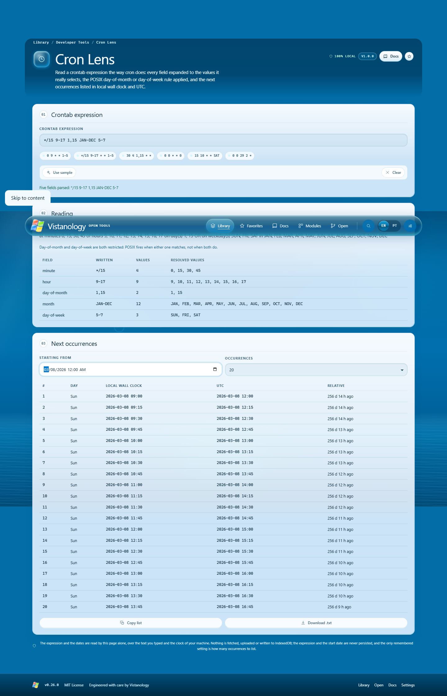
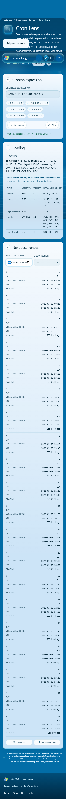

# Cron Lens · v1.0.0

Read a five-field POSIX crontab the way cron actually reads it: every field expanded to the concrete values it
selects, the day-of-month **or** day-of-week rule applied and named, and the next occurrences listed in local wall
clock and UTC from an anchor you choose.
Leia um crontab POSIX de cinco campos como o cron de fato lê: cada campo expandido nos valores que escolhe, a regra
de dia do mês **ou** dia da semana aplicada e nomeada, e as próximas ocorrências em relógio local e UTC a partir do
marco que você escolher.

Category: 04 Developer Tools · Engine: a pure wall-clock core (no `Date`, no timezone reads) with Sakamoto's
day-of-week formula, plus `Date` only where an instant is stamped · 100% local · no dependencies.

## Usage · Uso

- **Type or preset** — five fields, space-separated; typing is debounced 160 ms. Six preset chips cover the shapes
  people paste most: `0 9 * * 1-5`, `*/15 9-17 * * 1-5`, `30 4 1,15 * *`, `0 0 * * 0`, `15 10 * * SAT`,
  `0 0 29 2 *`. · Digite ou toque num exemplo pronto.
- **Field table** — one row per field: what you wrote, how many values it resolves to, and the values themselves,
  truncated after the first twelve. `*/15` in minutes becomes `0, 15, 30, 45`; `5-7` in day-of-week becomes
  `SUN, FRI, SAT` because 7 folds to Sunday. · Tabela de campos com valores resolvidos.
- **In words** — a plain-language sentence for the whole expression, and when both day fields are restricted a
  second line states the POSIX rule: fires when **either** one matches. · Frase em palavras mais a regra OU.
- **Next occurrences** — set *Starting from* (defaults to your clock) and pick 5, 10 or 20 rows. Each row carries the
  weekday, the local wall clock, the same instant in UTC, and the distance from now. · Ocorrências com dia da semana,
  relógio local, UTC e distância de agora.
- **DST marks** — a row whose wall clock does not exist in your timezone on that date gets a warning mark naming the
  time it resolved to. The tool shows the gap instead of hiding it. · Buraco de horário de verão é marcado, não ocultado.
- **Copy list / Download .txt** — the occurrence rows as plain text for a runbook. · Copiar ou baixar a lista.
- **Persistence** — only the occurrence count survives reload (`localStorage`, key `vistanology:cron-lens`). The
  expression and the anchor date are never written anywhere. · Só a quantidade de ocorrências é lembrada.

## Privacy · Privacidade

Parsing and scheduling happen in this page, over the text you typed and the clock of your machine. No fetch, no
worker, no upload, no IndexedDB — `VT.db.count()` stays `0` through a full session. The only persisted value is
`{"count":5|10|20}`.
Leitura e agendamento acontecem nesta página, sobre o texto digitado e o relógio da máquina. Nada é buscado, enviado
ou gravado no IndexedDB; o único valor salvo é `{"count":5|10|20}`.

## Limits · Limites

- **Five fields only.** A leading seconds field (Quartz and some 6-field crontabs) is refused rather than silently
  dropped, and Quartz's `?`, its year field and the `L`, `W`, `#` day modifiers are reported as unknown values.
  Só cinco campos; o campo de segundos e os modificadores do Quartz são recusados, não ignorados em silêncio.
- **Ranges do not wrap.** `FRI-SUN` is refused because Friday is 5 and Sunday is 0 or 7; write `FRI,SAT,SUN` or
  `5-7`. This follows the published POSIX rule, not every cron implementation.
  Intervalos não dão a volta — segue a regra POSIX publicada.
- **OR vs AND.** Day-of-month and day-of-week combine as OR when both are restricted and AND when only one is; the
  page prints which rule it used, because this surprises people often.
  Dia do mês e dia da semana se combinam como OU quando ambos restritos.
- **Wall clock first, instant second.** In a timezone with daylight saving, the time you wrote either does not exist
  once a year or happens twice; the table marks the row rather than pretending the schedule is exact. Cron on that
  machine follows its own timezone database, not this page. A repeated fall-back wall clock is listed once.
  O horário escrito pode não existir ou existir duas vezes; a linha é marcada.
- **Bounded search.** A schedule that never matches — `0 0 31 2 *` — is answered after about twelve years of
  candidate days (4400 days). That bound is what makes a February-29 schedule reachable in one frame; anything rarer
  is answered with "never fires" rather than a guess.
  Busca limitada a cerca de doze anos.

## Verified · Verificado

The scheduler ships as a delimited pure core inside `js/apps/cron-lens.js`, sliced out by `_dev/probe-cron.js` with
`new Function` — so the tested code is the running code, not a reimplementation.

**Node, `_dev/probe-cron.js` — 118 probes, 0 failed:**
- **Expansion** — `*/15` minutes → `0,15,30,45`; `9-17` hours → 9 values; `1,15` → 2; `JAN-DEC` → 12 names;
  `5-7` day-of-week → `SUN, FRI, SAT` (7 folded to 0). Expansões conferidas campo a campo.
- **19 rejections, each named** — empty, out-of-range value, reversed range, zero step, `*` mixed with other terms,
  unknown names, and the Quartz-only `?` and `L`. · Dezenove rejeições nomeadas.
- **Calendar** — Sakamoto's formula cross-checked against `Date.UTC` over 4000 random dates from 1901 to 2200, plus
  known anchors; leap rules include `2100` not leap and `2000` leap.
  Dia da semana conferido contra `Date.UTC` em 4000 datas.
- **Occurrence lists, hand-computed** — weekday skipping, `*/15` quarters, anchor-inclusive `15 10 * * *`, the
  February-29 cycle landing on `2028 / 2032 / 2036`, the century skip to `2104 / 2108`, `0 0 31 2 *` answering
  "never fires", the POSIX union of `0 9 13 * 5`, and `0 0 29 2 1` firing on February Mondays because the month
  always ANDs. · Listas de ocorrências calculadas à mão.
- **Sentences** — EN and PT shapes, including the OR clause and the twelve-value truncation ellipsis.

**Headless Chromium, `_dev/qa-cron-lens-qoder.js` — 110 assertions, 0 failed** against the local preview
(`node serve.js`):
- **Registry and empty state** — the manifest contract holds; before input the page prompts and computes nothing,
  Copy and Download stay disabled. · Estado vazio limpo.
- **Sample and field table** — `0 9 * * 1-5` renders five exact rows; presets each parse. · Tabela conferida.
- **Occurrences** — rows are re-derived in the harness through an independent UTC path (`new Date(local).toISOString()`)
  and the relative column is audited for `in`/`ago` direction. · Ocorrências re-derivadas.
- **Daylight saving** — no row is marked in the machine's own zone (America/Sao_Paulo, no DST since 2019), and in a
  context pinned to `America/New_York` the 2026-03-08 `02:30` row is the only marked one: its title names `03:30` and
  its UTC reads `2026-03-08 07:30`, the same instant as 2026-03-07 `02:30` EST. The 2026-11-01 fall-back wall clock is
  listed once and not reported as a gap. · Buraco marcado, repetição listada uma vez.
- **Malformed input** — four fields, six fields, `61`, `0 0 32 * *`, `10-2`, `*/0` each print their own message.
  · Seis entradas inválidas, seis mensagens distintas.
- **Never-fires and OR rule** — `0 0 31 2 *` answers after the bounded search; `0 9 13 * 5` announces the OR.
  · Nunca-dispara e regra OU anunciadas.
- **Storage and exports** — the persisted object is exactly `{count}`; copy and download produce the same text.
  · Persistência e exportação conferidas.
- **Portuguese** — weekday sentences, rejections and status all render in PT with no raw `cl.*` key leaking.
  · Cobertura PT sem chaves cruas.
- **Privacy and teardown** — `VT.db.count() === 0`, a remount starts from an empty expression, and the console stays
  clean through the whole run. · IndexedDB intocado, console limpo.

**Also run:** `_dev/qa-newtool-responsive-qoder.js` — 10 probes × 3 states (glass, Solid, Reduced) × 6 widths
(1440→375), 0 failures, with the widest bench the tool can hold (20 occurrences of
`*/15 9-17 1,15 JAN-DEC 5-7` anchored at 2026-03-08). At 375 px each occurrence row stacks with its column name
carried on the row. Plus `_dev/scan-i18n-parity.js` (0 failures) and the docs contract sweep
`_dev/qa-docs-all.js` (38 pages, 0 failures).
