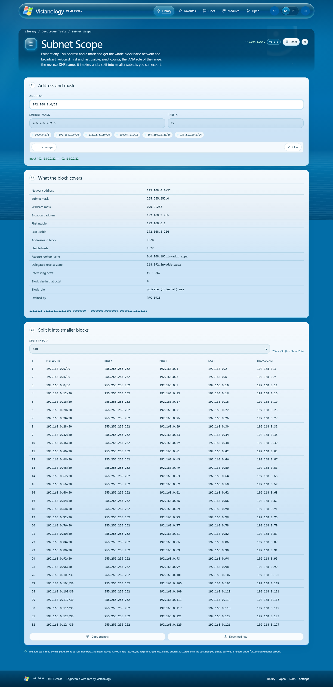
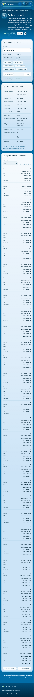

# Subnet Scope · v1.0.0

Point an IPv4 address and a mask at the page and get the whole block back: network and broadcast, wildcard, first
and last usable, exact counts, the IANA role of the range, the reverse-DNS names it implies, and a split into
smaller subnets you can export as CSV.
Aponte um endereço IPv4 e uma máscara e receba o bloco inteiro: rede e broadcast, curinga, primeiro e último
utilizáveis, contagens exatas, o papel do intervalo na IANA, os nomes reversos que ele implica e a divisão em
sub-redes menores exportável em CSV.

Category: 04 Developer Tools · Engine: integer arithmetic on 32-bit numbers (`AND`, `OR`, shifts) — no fetch, no
registry lookup, no locale · 100% local · no dependencies.

## Usage · Uso

- **Three ways in** — `192.168.0.0/22`, `10.0.0.1 255.255.255.0`, or a bare address, which is read with its classful
  mask. The address, mask and prefix fields stay in step; only the address line is ever parsed. · Endereço, máscara
  em pontos ou prefixo — os três campos acompanham.
- **Scope table** — network, mask, wildcard, broadcast, first and last usable, the exact number of addresses and of
  hosts, and the interesting octet with the step it moves by. · Tabela do escopo com as duas exceções do menos dois.
- **Block role** — matched against a static table of the IANA special-purpose registry by longest prefix: RFC 1918
  private, RFC 6598 shared (CGNAT), RFC 3927 link-local, RFC 5737 documentation, RFC 2544 benchmarking, RFC 5771
  multicast and more, each printed with its RFC. · Papel do bloco pela IANA, com a RFC.
- **Reverse names** — the `in-addr.arpa` form of the address, and the classful zone a delegation of this block sits
  in. · Nomes reversos e a zona delegada.
- **Split** — choose a target prefix; the count is `2^(target − current)` and the table lists the subnets with their
  own spans. The list caps at 32 rows while the count stays exact. · Divisão com contagem exata e lista limitada a 32.
- **Copy / Download .csv** — six columns, one line per subnet, for a DHCP scope or a routing note. · Copiar ou
  baixar CSV.

## Privacy · Privacidade

The address is parsed in this page into four numbers and compared with a static table. No fetch, no worker, no
upload, no IndexedDB, and no address is ever written to storage — the harness proves this by scanning every
localStorage value for the addresses that were typed. The only persisted key is `vistanology:subnet-scope` holding
`{"target":nn}`.
O endereço é parseado nesta página e comparado a uma tabela fixa. Nada é buscado ou gravado; nenhuma linha de
endereço vai para o armazenamento — só `{"target":nn}`.

## Limits · Limites

- **IPv4 only.** No IPv6 and no `::ffff:` translation: a four-octet parser that pretended otherwise would promise
  more than it can keep. · Só IPv4.
- **Leading zeros are refused, not guessed.** `010.0.0.1` is octal in some stacks and decimal in others, so the page
  asks for it plainly. · Zeros à esquerda são recusados.
- **The reserved table is static.** It is accurate for the ranges it lists and silent about the rest; it is not a
  live query, so a recent assignment can be missing. · Tabela fixa, não consulta ao vivo.
- **Minus two, with the exceptions shown.** A /31 is two usable ends (RFC 3074) and a /32 is one host; anything
  assuming every block has a usable middle will disagree with those rows. · Exceções impressas, não escondidas.
- **Arithmetic, not a survey.** Nothing probes a host, and no row here means an address is free, routed or
  reachable. · Não sonda a sua rede.

## Verified · Verificado

The maths ships as a delimited pure core inside `js/apps/subnet-scope.js`, sliced out by `_dev/probe-subnet.js` with
`new Function`, so the probe drives the functions the page runs.

**Node, `_dev/probe-subnet.js` — 124 probes, 0 failed:**
- **Packing** — `192.168.0.1` is 3232235521 and back; `255.255.255.255` stays unsigned at 4294967295; three octets,
  five octets, letters, `256`, and `010` are each refused with the offending value named. · Empacotamento e recusas.
- **Masks** — all 33 prefixes survive the mask round trip, and `255.0.255.0` / `255.255.254.1` are refused as
  non-contiguous. · Round trip dos 33 prefixos.
- **Blocks, by hand** — `192.168.0.0/22` spans `192.168.0.0`–`192.168.3.255` with wildcard `0.0.3.255`, 1024
  addresses, 1022 hosts and the step in the third octet by 4; `192.168.1.130/25` falls into `.128`–`.255`; `/31` and
  `/32` print their exceptions; `/0` counts 4294967296 as an integer, not a float. · Blocos calculados à mão.
- **IANA at the edges** — `172.31.255.255` private but `172.32.0.1` public; `100.127.255.255` shared but
  `100.63.255.255` public; `198.19.255.255` benchmarking but `198.20.0.1` public; `192.88.99.0` is the anycast and
  `192.88.99.1` is not; `255.255.255.255` beats the /4 it sits inside. · Bordas dos intervalos.
- **Splits** — a /22 makes four /24s, sixteen /26s, 256 /30s listed up to the cap of 32; splitting into the same or
  a larger prefix is refused rather than faked. · Divisões conferidas.
- **Sizing** — 254 hosts need a /24, 255 jumps to a /23, 1022 stays /22 and 1023 does not. · Dimensionamento.
- **Reverse DNS** — `192.168.0.1` → `1.0.168.192.in-addr.arpa`; a /22 delegates inside the /16 zone, a /25 inside a
  /24 zone. · Reversa conferida.

**Headless Chromium, `_dev/qa-subnet-scope-qoder.js` — 76 assertions, 0 failed** against the local preview
(`node serve.js`):
- **Empty state** — the panel waits, nothing is computed, exports disabled. · Estado vazio limpo.
- **The sample /22** — every row of the scope table compared with the hand-computed block, including the binary
  mask/wildcard line. · Tabela conferida linha a linha.
- **Nine reserved ranges** read through the UI, at their edges. · Nove intervalos pela interface.
- **The three fields stay coherent** — a dotted mask sets the prefix, the prefix field rewrites the address line, a
  gapped mask is refused by name, and a blur never re-parses a mask as an address. · Campos em passo.
- **2^32 printed exactly** — `4294967296` and `4294967294`, no float drift. · Contagem exata.
- **The exported CSV is opened from the browser's own download** and checked line by line: header order, the first
  /30 row, the 32nd row, and one line per listed subnet. · O CSV baixado é relido e conferido.
- **Bad input** — three octets, `256`, `010`, `/33` each say what broke and leave no half-read block on screen.
  · Entradas inválidas.
- **Privacy** — the stored object is exactly `{target}`, no localStorage value contains any address typed during
  the run, and `VT.db.count() === 0`. · Nenhum endereço é gravado.
- **Portuguese** — table labels, block roles and rejection messages render in PT with no raw `ss.*` key leaking.
  · Cobertura PT.
- **Console clean** through the whole run, including reloads and language switches. · Console limpo.

**Also run:** `_dev/qa-newtool-responsive-qoder.js` — 10 probes × 3 states (glass, Solid, Reduced) × 6 widths
(1440→375), 0 failures, loaded with the widest table the tool can make (32 subnets × 6 dotted-quad columns). Below
860 px each subnet becomes a stacked block carrying its column name. Plus `_dev/scan-i18n-parity.js` (0 failures)
and the docs contract sweep `_dev/qa-docs-all.js` (40 pages, 0 failures).
