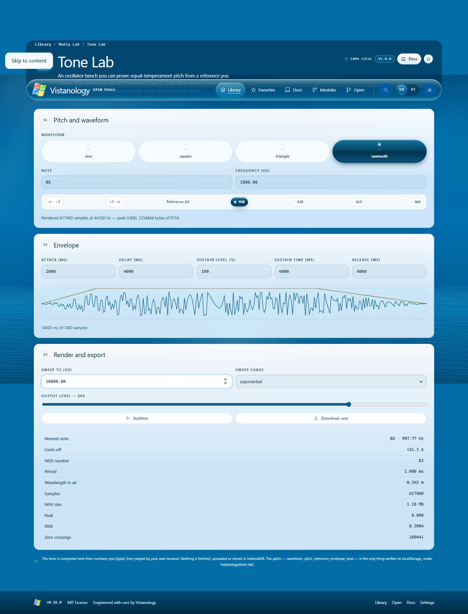
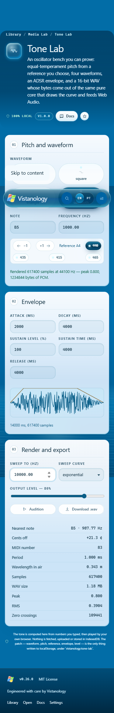

# Tone Lab · v1.0.0

An oscillator bench you can prove: equal-temperament pitch from a reference you choose, four waveforms, an ADSR
envelope, and a 16-bit WAV whose bytes come out of the same pure core that draws the curve and feeds Web Audio.
Uma bancada de oscilador que se pode provar: afinação de temperamento igual a partir de uma referência sua, quatro
formas de onda, envelope ADSR e um WAV de 16 bits cujos bytes saem do mesmo núcleo puro que desenha a curva e
alimenta o Web Audio.

Category: 03 Media Lab · Engine: pure arithmetic for pitch, envelope, samples and the RIFF encoder; Web Audio appears
once, as a playback sink · 100% local · no dependencies.

## Usage · Uso

- **Waveform** — four chips, each drawn from the same `waveSample` function the renderer uses, so the icon is the
  signal. · Quatro chips desenhados pela mesma função do renderizador.
- **Pitch, two ways** — type a note (`C#5`, `Bb3`) or a frequency (`1000`). A note becomes its exact
  equal-temperament frequency; a free frequency stays free and the facts table tells you which note it is nearest to
  and by how many cents. · Nota ou frequência; a nota é exata, a frequência livre mostra o desvio em cents.
- **Reference A4** — 440, 435, 415 or 465 in one tap. Changing it *scales* the frequency you have, so a free pitch
  keeps its relation to the new reference instead of jumping to a note. · Mudar a referência escala a frequência atual.
- **Envelope** — attack, decay, sustain level, sustain time and release in milliseconds. The curve on screen is the
  gain array the renderer multiplies the waveform by, sampled to 120 points. · A curva na tela é o array de ganho.
- **Sweep** — glide to a second frequency, exponentially (midpoint `√(f₀·f₁)`) or linearly (midpoint the arithmetic
  mean). It is stored as a ratio, clamped between 0.1× and 10×, so it transposes with the note. · Varredura guardada
  como razão, transpõe junto.
- **Audition / Download .wav** — playback and export read the same rendered array; the file is mono 16-bit PCM at
  44 100 Hz with no compression. · Ouvir e baixar usam o mesmo array renderizado.

## Privacy · Privacidade

The tone is computed in this page from the numbers you typed and played by your own browser. No fetch, no worker, no
upload, no IndexedDB (`VT.db.count()` stays `0`). The patch is the only value written to storage:
`{"wave","hz","a4","gain","curve","sweepOn","sweepRatio","env"}` under `localStorage` key `vistanology:tone-lab`.
O tom é calculado localmente e tocado pelo seu navegador. Nada é buscado, enviado ou gravado no IndexedDB. Só o
patch vai para o `localStorage`.

## Limits · Limites

- **Naive oscillators, not band-limited.** Square and sawtooth are one value per sample, so they alias above roughly
  2 kHz — audible as extra partials. A production synth would use polyBLEP or wavetables.
  Osciladores ingênuos: aliasam acima de ~2 kHz.
- **The reference changes the maths, not your speakers.** Nothing is measured or calibrated; output level is a plain
  multiplier. · Nada é medido ou calibrado.
- **Wavelength assumes 343 m/s** — dry air near 20 °C. Temperature, humidity and CO₂ shift it; it is a physics
  readout, not a room measurement. · Comprimento de onda usa 343 m/s.
- **Straight-line segments only.** Attack, decay and release are linear between exact sample boundaries; real synths
  often use exponential curves, which change the sound of a pluck more than these numbers do. · Segmentos retos.
- **Audition needs a device and a gesture.** Where the browser refuses, the curve, the numbers and the WAV stay
  exact — only playback is missing. · Sem dispositivo, só falta a reprodução.

## Verified · Verificado

The signal path ships as a delimited pure core inside `js/apps/tone-lab.js`, sliced out by `_dev/probe-tone.js` with
`new Function`, so the code the probe checks is the code the page runs.

**Node, `_dev/probe-tone.js` — 136 probes, 0 failed:**
- **Temperament** — `midiToFreq(69,440) === 440`, octaves are exactly ×2 and ÷2, C4 = 261.625565300595 Hz, and every
  MIDI note 0–127 survives the frequency round trip. · Oitava exata e round trip dos 128 números MIDI.
- **Naming** — `C#`/`Eb`/`Ab`/`Bb` spellings, `C-1` at midi 0, `G9` at midi 127; `parseNote` accepts `a4`, `bb3`,
  `C-1` and refuses `A` (no octave), `440`, `H4`, `A4.5`. · Soletração e recusas conferidas.
- **Cents** — one cent above the reference reads back as exactly 1.0, one below as −1.0; a named note is 0. · Um cent
  exato nos dois sentidos.
- **Waveforms** — exact turning points for sine, square, triangle and sawtooth; a 48-sample square cycle is 24 high
  and 24 low. · Pontos exatos por forma de onda.
- **Envelope boundaries** — at 44.1 kHz a 10/70/70%/180/140 patch is 441/3087/7938/6174 samples, the last attack
  sample is exactly 1, decay lands exactly on 0.7, the plateau holds it, and the last release sample is exactly 0;
  zero-length segments drop out; sustain above 100% or below 0 clamps. · Fronteiras exatas de amostra.
- **Sweeps** — exponential midpoint equals `√(440·880)`, linear midpoint equals 660, and a sweep to the same
  frequency reproduces the fixed tone sample for sample. · Ponto médio geométrico e aritmético.
- **WAV bytes** — every header byte checked: `RIFF`, chunk size, `WAVE`, `fmt `, PCM = 1, mono, 44100, byte rate
  88200 (`88 58 01 00`), block align 2, 16 bits, `data`, size; full scale is 32767 and −32767, hot samples clamp
  instead of wrapping, and half scale is −16383 after rounding. · Cabeçalho byte a byte.
- **Round trip** — every one of the 17 640 samples of a rendered tone comes back from its int16 encoding inside one
  quantisation step. · Todas as amostras voltam dentro de um passo de quantização.

**Headless Chromium, `_dev/qa-tone-lab-qoder.js` — 81 assertions, 0 failed** against the local preview
(`node serve.js`):
- **First paint is a real tone** — 17 640 samples, 35 324 bytes reported, one waveform pressed, no error state.
  · Primeira tela já renderiza um tom.
- **Facts panel** — period `2.273 ms`, wavelength `0.780 m`, MIDI 83 for 1000 Hz, and the cents error re-derived in
  the harness from `1200·log₂(1000/f)`. · Números re-derivados.
- **Hand-counted signal** — zero crossings land on `2·f·t = 352` for the fixed tone, ~498 for an exponential octave
  sweep and ~528 for a linear one; sweeping does not change the length. · Cruzamentos de zero conferidos à mão.
- **The downloaded file** — the harness intercepts the browser's own download and reads it back: 35 324 bytes,
  `RIFF`/`WAVE`/PCM/mono/44100/16-bit, the data chunk holding every sample, the first sample zero because the sine
  starts at zero, the sample at the end of the attack equal to the sine value at that phase, and the last sample
  silent. · O arquivo baixado é aberto e conferido byte a byte.
- **Audition** — Web Audio accepted playback on this machine; the button became Stop and returned to Audition when
  the tone ended. Where a browser refuses, the bench says so instead of failing silently. · Reprodução real conferida.
- **Bad input** — `H4` and 5 Hz each print their own message and leave the last good pitch on screen. · Entrada
  inválida sinalizada.
- **Storage** — the patch is exactly eight keys, the sweep survives as a ratio, and `VT.db.count() === 0`.
  · Persistência conferida chave a chave.
- **Portuguese** — waveform names, facts labels, status and envelope length all render in PT with no raw `tl.*` key
  leaking. · Cobertura PT sem chaves cruas.

**Also run:** `_dev/qa-newtool-responsive-qoder.js` — 10 probes × 3 states (glass, Solid, Reduced) × 6 widths
(1440→375), 0 failures, with the widest patch the bench holds (a 14-second sawtooth, 617 400 samples, sweeping to the
ratio clamp at 10 000 Hz). Plus `_dev/scan-i18n-parity.js` (0 failures), the docs contract sweep
`_dev/qa-docs-all.js` (39 pages, 0 failures) and `_dev/qa-shell-qoder.js` (39 tools × 6 widths × 2 languages, exit 0).
